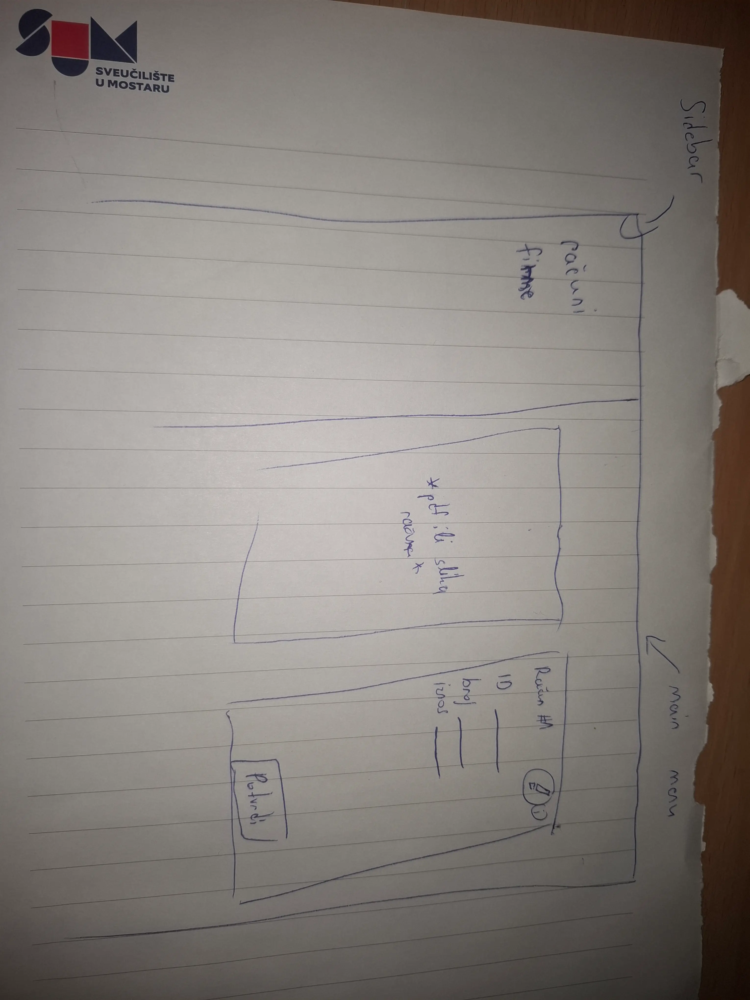

# Aplikacija za pregled ulaznih računa

Sučelje za računovođu za pregled i potvrdu ulaznih računa: originalni dokument prikazan uz izvučene podatke, uz jasno istaknute sve nesigurne ili nedostajuće vrijednosti.

## Pokretanje

Potreban je Node 22.12+ i Yarn 1:

```bash
make start      # ili: yarn install && yarn dev
```

Otvori http://localhost:5173.

Bez Nodea, samo s Dockerom:

```bash
make docker
```

Otvori http://localhost:8080 (prvi build traje nekoliko minuta).

## Kratak opis/svrha aplikacije

Svrha aplikacije je olakšavanje i ubrzavanje svakodnevnog posla računovođe koji prolazi kroz velik broj ulaznih računa za više različitih firmi. Zamišljam da često radi pod pritiskom vremena i da mu nije cilj provesti što više vremena u aplikaciji, nego što brže uočiti grešku, potvrditi ispravne podatke i nastaviti na sljedeći račun. Zato sam se fokusirao na to da original računa i izvučeni podaci budu odmah jedan uz drugi, a ne da računovođa troši vrijeme skakanjem s jednog prozora na drugi i uspoređujući. Isto tako fokus je da stvari koje sustav nije dobro očitao ili nije siguran u točnost budu jasno uočljive kako bi se olakšao proces uređivanja/mijenjanja/prepravljanja računa.

## (Ne)Rješenja

- Original i očitani podaci su jedno uz drugo na jednom ekranu. Time je riješen problem stalnog prebacivanja s prozora na prozor i nepotrebnog gubljenja vremena.
- Računovođa ima glavnu riječ - on može potvrditi račun iako taj račun možda sadrži više upozorenja ili nepotpuno očitanih polja (Aplikacija neće automatski blokirati/potvrditi račune). Aplikacija je tu da ubrza i olakša proces, a ne da odlučuje umjesto računovođe.
- Ono što je namjerno izostavljeno je automatska potvrda računa, iako je očitavanje 100%. Kao što je već navedeno iznad, računovođa je taj koji odlučuje bez obzira što kaže sustav ili aplikacija.

## Tri pitanja koja bi postavio pravom računovođi

- Koja polja na računu stvarno provjeravate svaki put, a koja samo kad vam nešto izgleda sumnjivo? - Da bih znao koja polja staviti u veći fokus i vidljivost.
- Koji dio procesa vam oduzima najviše vremena ili stvara najviše frustracije? - Moja pretpostavka je bila gubljenje vremena na prebacivanju prozora i uspoređivanju, ali sigurno ima još stvari koje oduzimaju dosta vremena.
- Ključne stvari koje nedostaju u ovoj aplikaciji, a koje računovođi dodatno olakšavaju posao?

## Kako bih znao da aplikacija radi

Najvažnije bih mjerio koliko vremena računovođa u prosjeku potroši na pregled jednog računa i usporedio to sa starim načinom rada. Uz to bih pratio koliko računa uspije pregledati u određenom vremenu, koliko često mora ručno ispravljati podatke i koliko pogrešnih podataka ipak prođe nakon potvrde.

Novi način bih smatrao boljim ako računovođa može pregledati više računa u kraćem vremenu, bez povećanja broja grešaka. Dodatno bih pratio koliko često koristi označena upozorenja i pomažu li mu ona da brže pronađe problematična polja.

## AI

Za inicijalni plan i vizualizaciju projekta koristio sam ChatGPT. Dao sam mu opis zadatka s ciljem da mi pobliže objasni problem i rješenja i da mi vizualizira koncept.

Za development sam koristio Claude u VS Code-u.

- Kontekst projekta sam stavio u CLAUDE.md file
- napravio 2 Claude skilla - za commit i za review da bih ubrzao proces
- Koristio sam Auto i Plan Claude modove (Plan kada sam želio da mi Claude dobro razradi ideju i plan prije većeg feature-a)

Primjer gdje sam odbacio prijedlog AI-ja bio je ekran za pregled računa. Predloženo je da se confidence prikazuje samo kod problematičnih polja i da se polja uređuju tek nakon klika. Ja sam odlučio sva polja odmah prikazati kao inpute, prikazati confidence uz svako polje te odvojiti „Spremi promjene” od „Potvrdi račun”, jer mi je to prirodnije za korisnika koji kroz isti proces prolazi više puta dnevno.

## Skice

Skica na papiru prije kodiranja:



ChatGPT Mockup sučelja:


